<h1 align="center">KEYPOS</h1>

<p align="center">
  <b>A point of sale for small shops, with a full audit trail and real offline selling.</b><br>
  FastAPI · PostgreSQL · installable web app (PWA) for cheap Android phones
</p>

<p align="center">
  
  
  <a href="LICENSE"></a>
</p>

---

> **🚧 Development preview.** KEYPOS is still being built. This repository shows where the
> project is today so others can try it and help improve it. It is **not yet certified for
> tax invoicing**: SAF-T export and tax compliance are the biggest open areas
> ([see below](#help-wanted-saf-t-and-tax-compliance)). A full roadmap will be published soon.

KEYPOS is a point-of-sale system built for real small shops: mini-markets, bottle stores,
kiosks and wholesalers. It was designed in a working shop, on cheap Android phones, with
unreliable internet, and with one rule: **every movement of stock, cash or card must be
traceable to a person, a shift and a reason.**

It is being tested in a shop in Luanda, Angola (Kwanza currency, Portuguese and English).

## Screenshots

| Register | Z-report | Inventory |
|---|---|---|
| 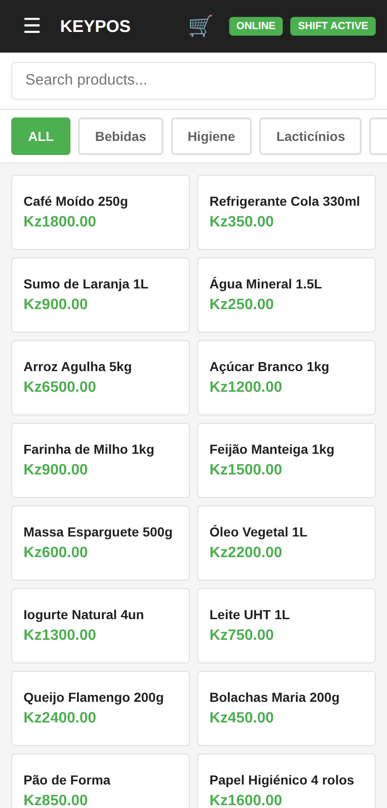 | 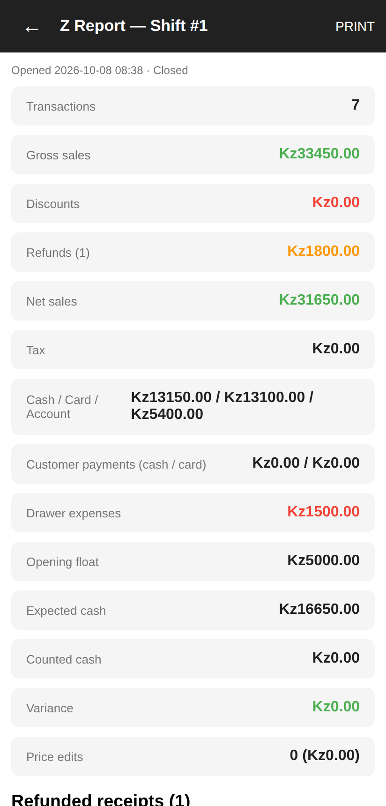 | 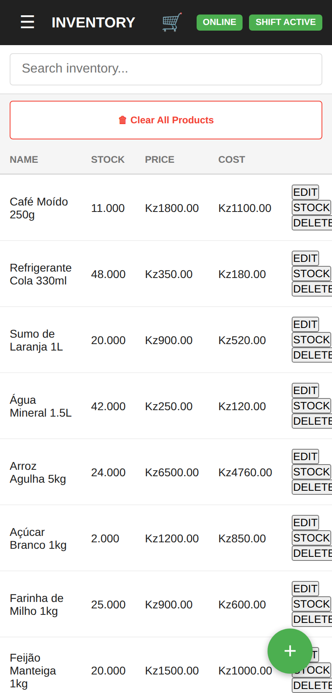 |

| Recent sales & refunds | Staff and roles | Day Sheet app |
|---|---|---|
| 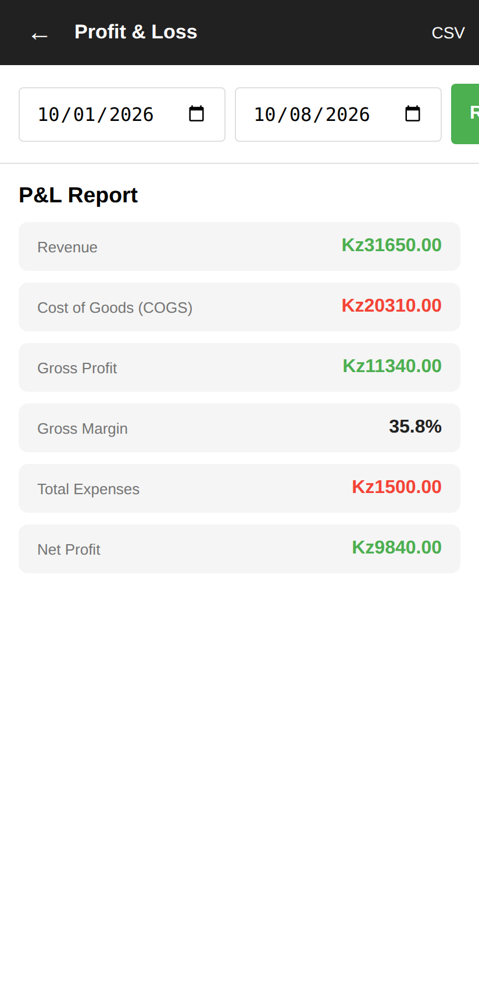 | 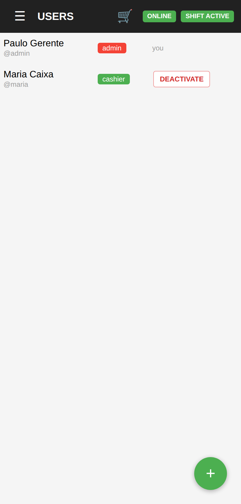 | 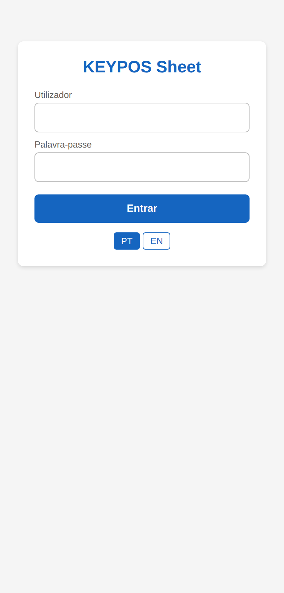 |

### The audit trail

Every shift's Z-report ends with the shift's full activity: refunds with their reason,
expenses paid from the drawer, stock corrections, price changes, customer payments and
account changes, each with the time and the person who did it.

| On a phone | On a tablet or PC |
|---|---|
| 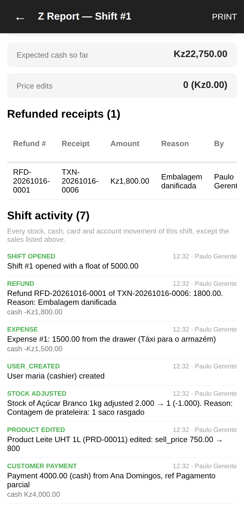 | 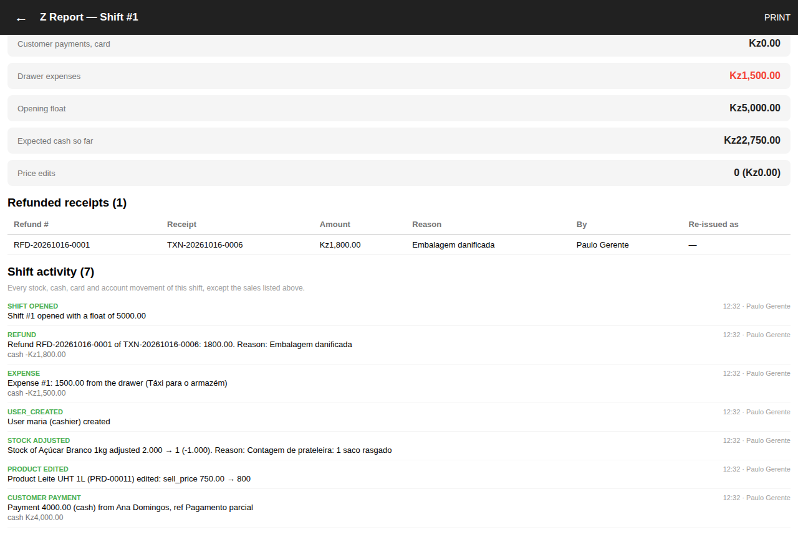 |

The trail is **append-only at the database level**. Triggers refuse any change, even from
the database superuser:

```text
pos_demo=# UPDATE audit_log SET summary = 'nothing happened' WHERE id = 2;
ERROR:  audit_log is append-only; UPDATE is not allowed
pos_demo=# DELETE FROM audit_log WHERE id = 2;
ERROR:  audit_log is append-only; DELETE is not allowed
```

### Reports

| Stock adjustments (reason required) | Profit & loss |
|---|---|
| 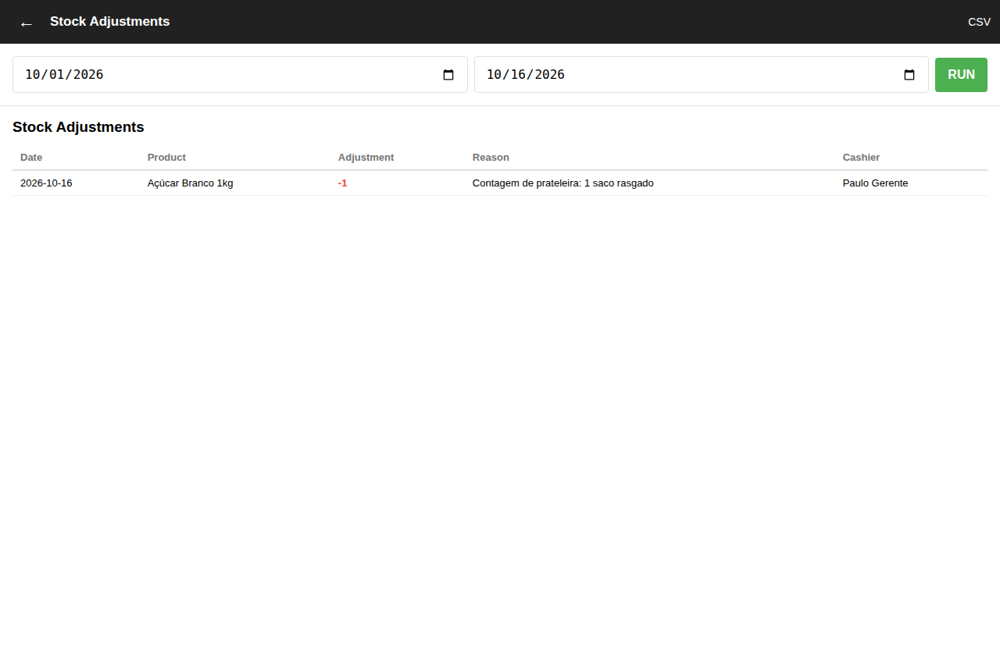 | 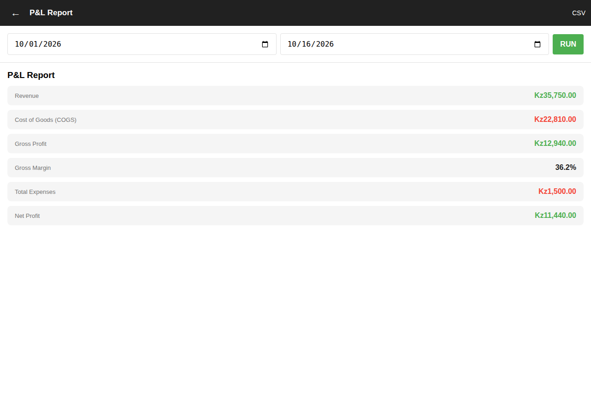 |

| Sales summary |
|---|
| 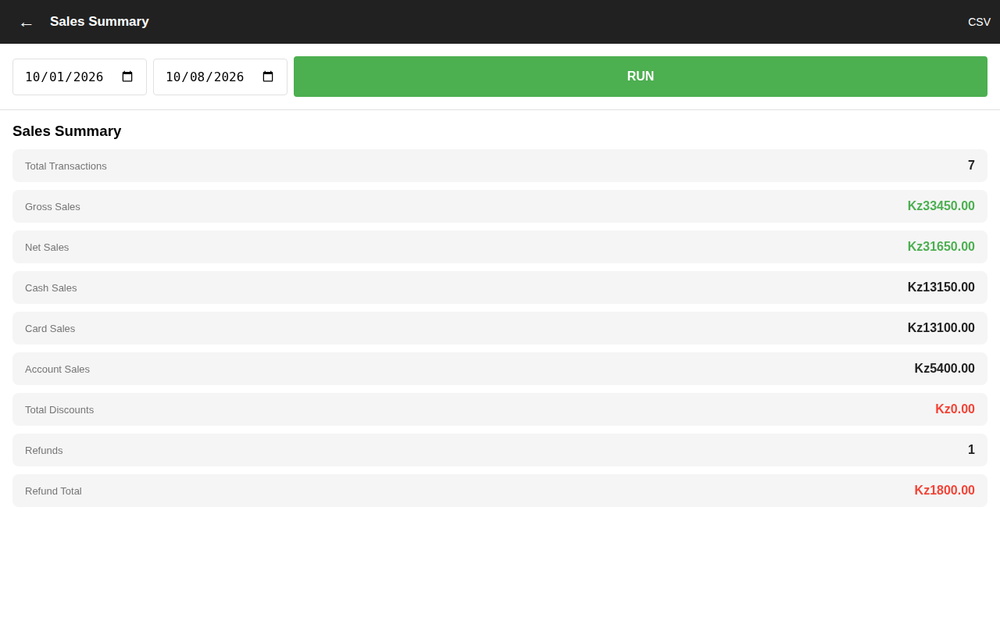 |

<sub>All screenshots use a fictional demo shop.</sub>

## Features

**Selling**
- Fast register with search-as-you-type, categories, held tickets and per-line discounts
- Cash, card, customer-account and split payments
- Prices typed at the till or fixed in the catalogue; every price change is logged

**Money you can trust**
- Shifts with opening float, counted cash and an end-of-shift **Z-report**
- **Whole-receipt refunds only**, with a mandatory reason, and only while the shift is open
- Re-issue a refunded receipt as a new linked receipt
- An **append-only audit trail**: database triggers refuse edits or deletes of audit records

**Stock**
- Live stock levels that can't be oversold online
- Purchase orders with weighted-average costing
- Stock adjustments that require a reason
- Low-stock, inventory value, profit & loss, tax and per-cashier reports

**Works offline**
- Sales made without internet are queued on the device (IndexedDB) and synced later
- Duplicate-proof sync: every sale carries a device id and client reference, so a retried sale is never recorded twice
- The device keeps its own stock count so it won't sell 11 when it has 9
- A service worker lets the app open with no connection at all

**Day Sheet**
- A separate, lightweight **KEYPOS Sheet** app for staff who only record the day's sales and expenses
- Manager approval before anything touches stock or cash; approval is all-or-nothing
- Excel (`.xlsx`) day sheets in Portuguese and English for phones with free Excel

**People**
- Roles (admin, manager, cashier, day sheet) with per-person permissions enforced by the server
- Every action is recorded under the signed-in user; 12-hour logins with refresh, and a deactivated account is signed out on its next request

## Help wanted: SAF-T and tax compliance

This is where KEYPOS needs the most help, and where it is furthest from finished. Today it
has **one shop-wide tax rate** and a simple tax report, and nothing more. In Angola, as in
Portugal and other countries that use SAF-T, a shop's invoicing software normally has to
meet the tax authority's rules (in Angola, the AGT). KEYPOS does **not** meet them yet.

If you know this area, we would love help with:

- **SAF-T (AO) export**: generating the XML file from sales, refunds, customers and products
- **Signed, chained documents**: the document signature and numbering rules certified
  invoicing software must follow, so no receipt can be altered or removed unnoticed
- **Tax model**: several IVA rates per product, exemptions and their legal reason codes,
  and tax shown correctly on receipts and refunds
- **Fiscal documents**: the right document types (invoice, invoice-receipt, credit note)
  and what each must print
- **Certification**: what an independent project needs to do to get certified
- Other countries' rules, if you'd like to use KEYPOS where you are

You don't need to write code to help. Explaining the rules in an issue, linking the
official specs, or reviewing a pull request is just as useful. See [CONTRIBUTING.md](CONTRIBUTING.md).

Other good places to start: translations, receipt printing, accessibility, and testing on
more phones.

## Architecture

```
frontend/   plain ES5 JavaScript PWA (runs on old Android WebViews), no build step
  sheet/    the separate Day Sheet app
backend/    FastAPI + async SQLAlchemy + PostgreSQL, Alembic migrations
  routers/  HTTP API          services/  business rules (sales, audit, day sheets, ...)
  models/   database tables   schemas/   request/response models
tests/      API and browser (Puppeteer) suites run against a disposable test database
tools/      stamp.py: content-hash cache busting for the JS files and service worker
```

The web server (nginx) serves `frontend/` and forwards `/api/` to the backend.

## Running it

Requires Python 3.12+, PostgreSQL 14+ and nginx.

```bash
cd backend
python -m venv venv && . venv/bin/activate
pip install -r requirements.txt -r requirements-dev.txt
cp .env.example .env                     # set SECRET_KEY and DATABASE_URL
python manage.py create-admin owner --name "Shop Owner"   # first admin; asks for a password
uvicorn main:app --host 127.0.0.1 --port 8005
```

Migrations run automatically at start-up, and `create-admin` runs them too, so it works on an
empty database. It only works while there is no admin yet. To reset a forgotten password from
the server console, use `python manage.py set-password <user> --generate`.

Minimal nginx site:

```nginx
server {
    listen 80;
    root /path/to/keypos/frontend;
    index index.html;
    location /api/ { proxy_pass http://127.0.0.1:8005; }
}
```

Put it behind HTTPS before real use: logins and the offline start-up both need it.

## Tests

```bash
cd backend && pytest -q                  # 104 tests, on a throwaway PostgreSQL database
cd tests && ./testenv.sh up && ./sweep.sh  # 21 API + browser suites against a test copy
```

After changing any frontend JavaScript, run `python3 tools/stamp.py` (`tests/check-shell.py` enforces it).

## Not there yet

- SAF-T export and tax certification (see [Help wanted](#help-wanted-saf-t-and-tax-compliance))
- Standalone builds that run without a server: Android APK and Windows/macOS/Linux desktop apps (early prototypes exist)
- Docker image for self-hosting
- A published roadmap (coming soon)

## License

KEYPOS is free software under the [GNU Affero General Public License v3.0](LICENSE).
You can use, study, change and share it. If you change KEYPOS and let other people use your
changed version, including over a network as a hosted service, you must make your changed
source code available to them under the same license.

Copyright (C) 2026 ASEIR Creations Inc.

---

<p align="center">
  KEYPOS is created by <b>ASEIR Creations Inc</b>.
</p>
